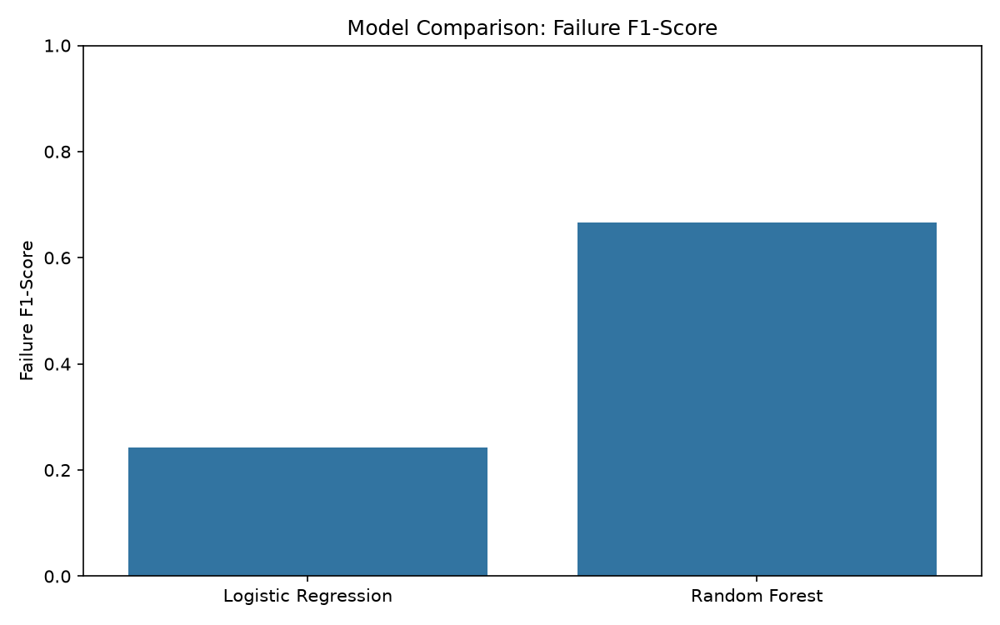
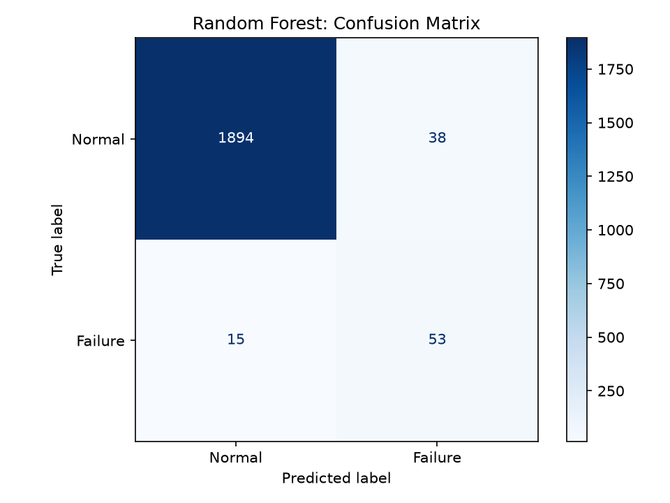
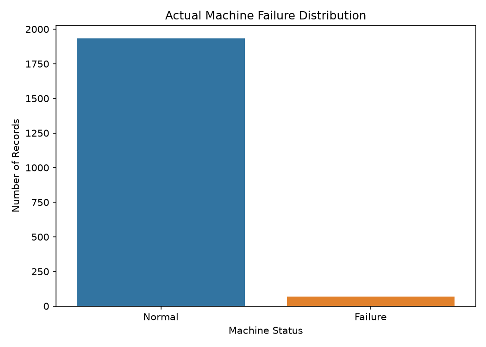

# AI-Powered Predictive Maintenance System for IoT Devices

A machine learning project that predicts potential machine failures using operating-condition data. It compares Logistic Regression and Random Forest models and provides an interactive Streamlit dashboard for predictions.

## Project Overview

Unexpected machine failures can cause downtime, maintenance costs, and productivity losses. This project explores how machine learning can help identify potential failures from machine operating conditions.

The project uses a publicly available predictive maintenance dataset and does not require physical IoT hardware.

## Features

- Real-world-style predictive maintenance workflow using a public dataset
- Data cleaning and preprocessing
- Comparison of Logistic Regression and Random Forest
- Evaluation using precision, recall, F1-score, and average precision
- Saved trained model and test predictions
- Confusion matrix and model evaluation charts
- Interactive Streamlit web application
- Predictions based on user-entered machine conditions

## Dataset

**Name:** AI4I 2020 Predictive Maintenance Dataset  
**Source:** UCI Machine Learning Repository

The dataset contains 10,000 records and 14 columns, including machine operating conditions and failure labels.

Dataset source: https://archive.ics.uci.edu/dataset/601/ai4i+2020+predictive+maintenance+dataset

The project uses these input features:

- Product type (`Type`)
- Air temperature (K)
- Process temperature (K)
- Rotational speed (rpm)
- Torque (Nm)
- Tool wear (minutes)

The target is `Machine failure`.

Identifiers and specific failure-mode columns are excluded from model inputs to avoid target leakage.

## Model Performance

Both models were evaluated on a held-out test set of 2,000 records.

| Metric | Logistic Regression | Random Forest |
|---|---:|---:|
| Accuracy | 82.45% | 97.35% |
| Failure precision | 14.18% | 58.24% |
| Failure recall | 82.35% | 77.94% |
| Failure F1-score | 0.2419 | 0.6667 |
| Average precision | 0.3818 | 0.7543 |

Random Forest was selected based on its higher failure-class F1-score.

The dataset is imbalanced, with 339 failure records among 10,000 records. Accuracy alone is therefore insufficient to assess failure detection.

## Project Structure

```text
AI-Predictive-Maintenance-IoT/
├── app.py
├── main.py
├── requirements.txt
├── data/
│   ├── raw/
│   └── processed/
├── src/
│   ├── preprocess.py
│   ├── train.py
│   ├── evaluate.py
│   └── predict.py
├── models/
│   └── predictive_maintenance.joblib
├── outputs/
│   ├── predictions/
│   └── reports/
├── images/
│   ├── model_comparison.png
│   ├── confusion_matrix.png
│   └── failure_distribution.png
├── notebooks/
└── docs/
```

## Installation

### 1. Clone the repository

```bash
git clone https://github.com/YOUR-USERNAME/AI-Predictive-Maintenance-IoT.git
cd AI-Predictive-Maintenance-IoT
```

### 2. Create and activate a virtual environment

Windows:

```bash
python -m venv .venv
.venv\Scripts\activate
```

### 3. Install dependencies

```bash
pip install -r requirements.txt
```

### 4. Prepare the dataset

Download and extract the UCI AI4I 2020 dataset.

Place `ai4i2020.csv` in:

```text
data/raw/ai4i+2020+predictive+maintenance+dataset/ai4i2020.csv
```

### 5. Preprocess the data and train the models

```bash
python -m src.preprocess
python -m src.train
```

### 6. Generate evaluation charts

```bash
python -m src.evaluate
```

### 7. Run prediction tests

```bash
python -m src.predict
```

### 8. Launch the dashboard

```bash
streamlit run app.py
```

## Evaluation Visualizations

### Model Comparison



### Confusion Matrix



### Failure Distribution



## Example Prediction

The interactive dashboard accepts machine operating conditions and displays the predicted status and estimated failure probability.

Example test scenarios showed both normal and failure predictions, demonstrating that the trained model responds to different input conditions.

## Limitations

- This is an educational machine learning project, not a deployed industrial monitoring system.
- The dataset is a benchmark dataset, not live sensor data from physical IoT devices.
- Model probabilities are estimates and are not guarantees of machine failure.
- Performance on real industrial equipment may differ from benchmark results.
- Predictions should not be used as the sole basis for safety-critical maintenance decisions.

## Future Improvements

- Add feature importance and model explainability
- Build a time-series monitoring simulation
- Add prediction history and downloadable reports
- Deploy the dashboard to a hosting platform
- Evaluate additional models and decision thresholds

## Technologies Used

Python, pandas, NumPy, scikit-learn, Matplotlib, Seaborn, Joblib, Streamlit, and Git.

## Author

**Jatin Gujarathi**

GitHub: https://github.com/jatingujju

LinkedIn: https://www.linkedin.com/in/jatin-gujarathi-bb16a7221/
